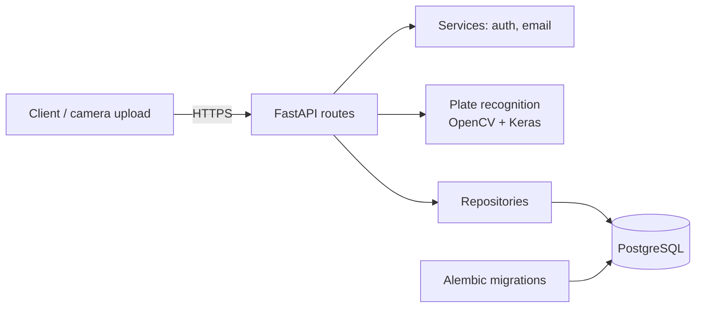

<sub>[← All projects](https://github.com/Nikita-devel)</sub>

# Parking System API

> Parking management backend that **recognises licence plates from entrance/exit photos**, opens and closes parking sessions, and bills them against a configurable rate and balance limit.

Team project (GoIT Python Developer programme, 4 developers, Scrum). **My role: team lead / Scrum master** — backlog, sprint planning, code review, delivery.

## Features

- **Plate recognition** — Haar cascade locates the plate, a Keras CNN reads the characters (OpenCV + TensorFlow/Keras).
- **Parking sessions** — `POST /entrance` and `POST /exit` take a photo, match the plate, open or close a session.
- **Billing rules** — admin sets the hourly rate and the balance limit; session history per plate.
- **Blacklist** — block or unblock a plate.
- **Auth & roles** — JWT access/refresh tokens, email confirmation, admin role management.

## Architecture



## Tech stack

| Layer | Tools |
|---|---|
| API | FastAPI, Pydantic, async SQLAlchemy |
| Data | PostgreSQL, Alembic |
| ML | OpenCV (Haar cascade), TensorFlow / Keras CNN |
| Auth | JWT (python-jose), email confirmation |
| Infra | Docker, Docker Compose |

## Getting started

```bash
git clone https://github.com/Nikita-devel/parking-system-api.git
cd parking-system-api
# create .env with POSTGRES_DB, POSTGRES_USER, POSTGRES_PASSWORD, POSTGRES_PORT, SECRET_KEY_JWT, mail settings
docker compose up -d          # PostgreSQL
alembic upgrade head
uvicorn main:app --reload     # http://localhost:8000/docs
```

## Project structure

```
main.py              # FastAPI app, middleware, router registration
src/routes/          # auth, users, parking, parking_services
src/services/        # JWT auth, email
src/repository/      # DB access
src/neural_network/  # plate detection + recognition
models/              # haarcascade.xml, model.h5
alembic/             # migrations
```

## Team

Built with [serhiikhkr](https://github.com/serhiikhkr) and [yerkovlad](https://github.com/yerkovlad).
